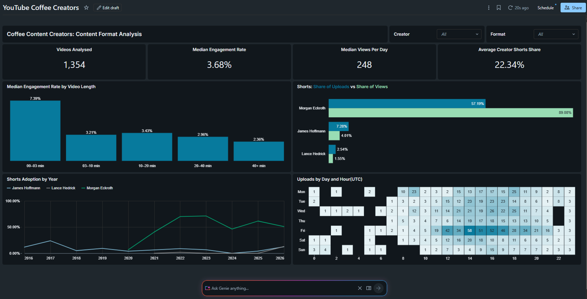
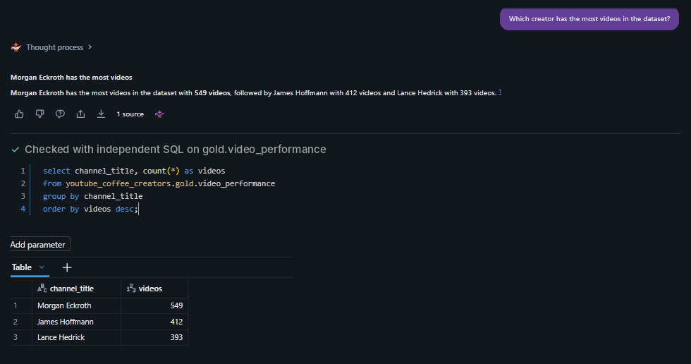
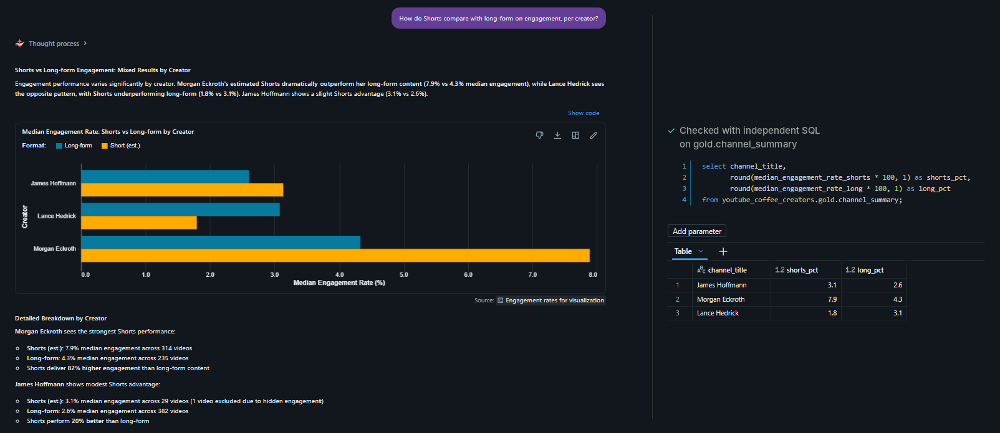
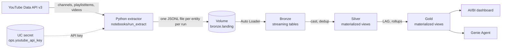
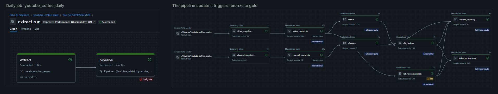

# YouTube Coffee Creators on Databricks

Public YouTube statistics for three coffee creators (James Hoffmann, Lance Hedrick and Morgan Eckroth), extracted with **Python**, modeled bronze to gold in a **Lakeflow declarative pipeline** on **Databricks**, and served in an **AI/BI dashboard** and a **Genie Agent**. The question: which content formats drive engagement?

Free Edition dashboards cannot be shared publicly, so the dashboard is shown as a screenshot.



A Genie Agent answers questions in plain English over the gold layer, and every answer shows its SQL. Answers are checked against independent SQL.





## How the data flows



| Layer | Object | Grain | Type |
|---|---|---|---|
| Landing | `bronze.landing` volume | One JSONL file per entity per extractor run | Volume |
| Bronze | `video_snapshots`, `channel_snapshots` | Rows as landed, all columns strings | Streaming table |
| Silver | `video_snapshots`, `channel_snapshots` | One row per video or channel per snapshot, typed and deduplicated | Materialized view |
| Silver | `videos`, `channels` | Current state: rows in the latest snapshot | Materialized view |
| Gold | `fct_video_snapshots` | Periodic snapshot fact: one row per video per snapshot, with `views_gained` | Materialized view |
| Gold | `dim_videos` | One row per current video, with length band and Shorts estimate | Materialized view |
| Gold | `channel_summary` | One row per channel: subscribers, Shorts shares, median engagement | Materialized view |
| Gold | `video_performance` | One wide row per published video, for the dashboard and Genie | Materialized view |

Everything lives in the `youtube_coffee_creators` catalog: one schema per layer, plus `ops` for the API key.

A daily Lakeflow Job runs the extractor from `main`, then the pipeline update.



## Design decisions

**Ingestion**
- The extractor reads the uploads playlist instead of `search.list`: complete, ordered, and far cheaper in quota (about 59 units a run).
- It writes JSON Lines files and stays plain Python with no Spark dependency, so the same script runs on a laptop or in a Databricks notebook. The notebook only sets the API key and output path.
- Each file is written to a hidden `.tmp` file and renamed, and bronze reads only `*.jsonl`, so a partial file is never ingested.
- Landing files are never deleted. The API cannot return past statistics, so the volume is the only record of history.

**Bronze**
- Auto Loader streaming tables load each file exactly once. A rerun with no new files adds nothing.
- Values stay as the API sends them (strings), plus `_source_file` and `_ingested_at` for lineage.

**Silver**
- Typed, deduplicated snapshots, one row per video per snapshot. Hidden likes and comments stay NULL, never 0.
- No SCD2. Snapshots already hold the history, and views and subscribers are measures, not descriptive attributes.
- Materialized views, because deduplication and latest-snapshot filters need the whole table. Serverless decides per view: the snapshot tables, `dim_videos` and the fact refresh incrementally, while the latest-snapshot views fully recompute, in seconds at this volume.

**Gold**
- `fct_video_snapshots` is a periodic snapshot fact. `view_count` is semi-additive (sum across videos within one snapshot only); `views_gained` is fully additive over time.
- `views_gained` is NULL on a video's first snapshot, and `hours_since_previous` sits next to every gain because snapshot intervals are uneven.
- `video_performance` is one wide, documented table, so the dashboard holds no joins and Genie answers from a single source.
- Counts are stored next to rates, and engagement uses the median so a few viral videos do not skew it.

**Platform**
- Two-part table names everywhere (`silver.videos`). No table depends on the pipeline's default schema, and the catalog comes from the bundle target.
- The pipeline is source-controlled as a Declarative Automation Bundle in a Git folder.
- The API key is a Unity Catalog secret in its own `ops` schema, governed by grants.
- Added packages are pinned; `requests>=2.32.4,<3` is a range so serverless keeps its own copy.

**Naming**
- Unit suffixes on measures and timestamps: `_secs`, `_utc`.
- `format` values say `Short (est.)` because the API has no Shorts flag.

## Run it

**Prerequisites:** a YouTube Data API v3 key and a Databricks workspace (built on Free Edition).

1. Create the catalog, schemas and volume:

```sql
create catalog if not exists youtube_coffee_creators;
create schema if not exists youtube_coffee_creators.bronze;
create schema if not exists youtube_coffee_creators.silver;
create schema if not exists youtube_coffee_creators.gold;
create schema if not exists youtube_coffee_creators.ops;
create volume if not exists youtube_coffee_creators.bronze.landing;
```

2. In Catalog Explorer, create a secret named `youtube_api_key` in `youtube_coffee_creators.ops`.
3. Add this repo as a Git folder and run `notebooks/run_extract` (serverless environment version 4 or later). It writes one file per entity to `/Volumes/youtube_coffee_creators/bronze/landing/`.
4. Run the `youtube_pipeline_etl` pipeline, or let the daily `youtube_coffee_daily` job run the extractor and the pipeline in sequence.
5. Open the dashboard in `dashboards/`, and create a Genie Agent on `gold.video_performance` and `gold.channel_summary`.

To run the extractor locally instead:

```powershell
python -m venv .venv
.venv\Scripts\Activate.ps1
pip install -r requirements.txt
copy .env.example .env    # then set YOUTUBE_API_KEY
python extract\main.py    # writes to output\
```

## Project structure

```
├── extract/                 Python extractor: YouTube Data API v3 to JSONL
├── notebooks/run_extract    Runs the extractor on Databricks, writing to the volume
├── youtube_pipeline/        Declarative Automation Bundle
│   ├── databricks.yml       Targets: dev and prod
│   ├── resources/           Pipeline definition
│   └── src/youtube_pipeline_etl/transformations/
│       ├── bronze.sql
│       ├── silver/          One file per table
│       └── gold/            One file per table
├── dashboards/              AI/BI dashboard (.lvdash.json)
├── docs/images/             README screenshots
└── requirements.txt
```

## Checks

- The extractor fails the run if the rows written differ from the rows fetched, and logs videos listed in a playlist but not returned (private or deleted).
- Bronze row counts per `_source_file` match the extractor log (1,355 videos and 3 channels per snapshot).
- Expectations in the pipeline:

| Expectation | Table | Action | First run |
|---|---|---|---|
| `video_id is not null` | `silver.video_snapshots` | Drop row | 0 dropped |
| `channel_id is not null` | `silver.channel_snapshots` | Drop row | 0 dropped |
| `views_gained >= 0 or views_gained is null` | `gold.fct_video_snapshots` | Warn | 202 of 2,710 flagged |

- The 202 falling view counts came from snapshots 4 to 13 minutes apart. View counts are not perfectly consistent between API calls, so small drops over short gaps are noise. Warn-only keeps the rows visible instead of silently dropping 5% of the fact.
- Genie answers were checked against independent SQL, including a cross-check between `video_performance` and `channel_summary`.


## Known limitations

- Shorts are estimated: 3 minutes or less. Before October 2024 the Shorts limit was 60 seconds, so earlier years include some short regular videos.
- YouTube changed Shorts view counting on March 31, 2025 (every start or replay counts), which lowers Shorts engagement rates compared with long-form.
- Subscriber counts are rounded by YouTube to 3 significant figures, so daily subscriber changes are not meaningful.

**Stack:** Python, YouTube Data API v3, Databricks (Unity Catalog, Auto Loader, Lakeflow declarative pipelines, AI/BI dashboards, Genie), Declarative Automation Bundles, SQL.
